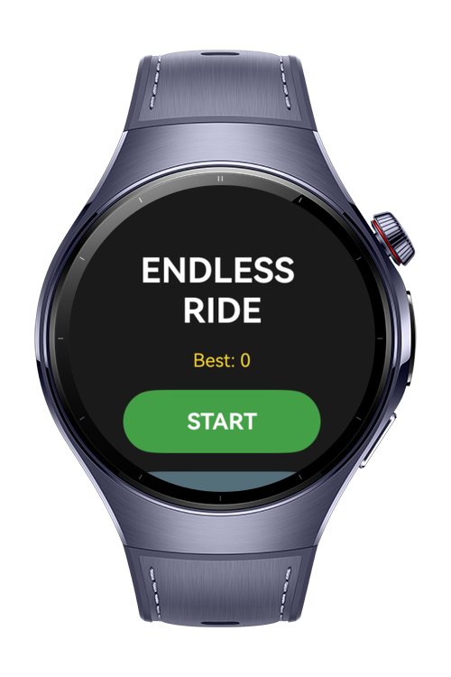
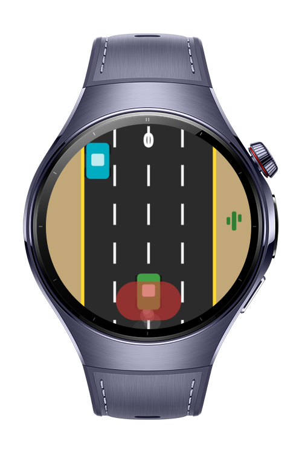
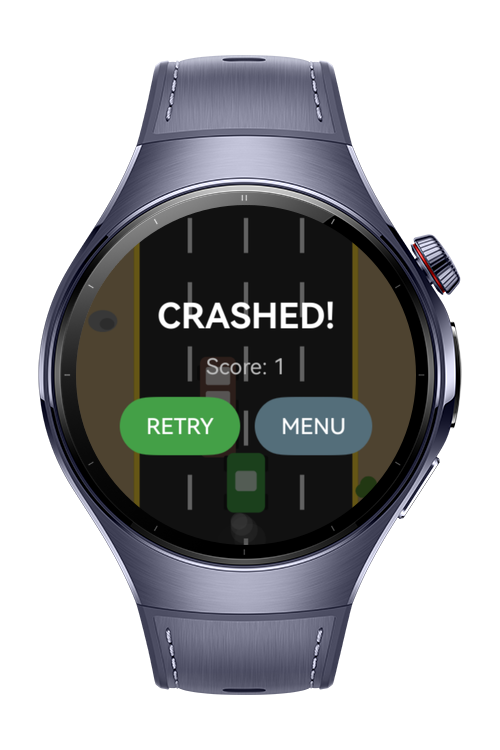

> **Note:** To access all shared projects, get information about environment setup, and view other guides, please visit [Explore-In-HMOS-Wearable Index](https://github.com/Explore-In-HMOS-Wearable/hmos-index).

# Car Game Sample App

Endless Ride is a 2D endless car game built with ArkTS / ArkUI for HarmonyOS
**wearable** devices. The car accelerates on its own while the player steers
between lanes to dodge oncoming traffic, brakes to survive, and chases a
persistent best score. The game ships with in-app localization (Turkish,
English, Chinese), multiple wheeled vehicle types, an animated smoke trail and
a touchless finger-tap brake.

# Preview

<p>
  
  
  
</p>

# Use Cases

- **Play an endless lane-dodging car game on the watch.** The car speeds up over
  time; the player steers left/right to avoid obstacle vehicles and passes as
  many as possible to raise the score. The best score is stored persistently.
- **Steer by touch or by tilt.** In Touch mode, holding the left/right half of
  the screen steers that way. In Tilt mode, tilting the watch left/right steers
  via the accelerometer, with an adjustable sensitivity.
- **Brake to survive.** Holding the on-screen brake button slows the car (rear
  brake lights turn on) without resetting the earned cruising speed.
- **Brake with a touchless hand gesture.** When enabled, tapping the thumb
  against a finger — without touching the screen — is recognized from the
  accelerometer and brakes briefly; repeated taps keep braking.
- **Switch the UI language on the fly.** Turkish, English and Chinese are
  selectable in Settings and applied live across every page.

# Technology

## Stack

- **Language:** ArkTS (TypeScript-based HarmonyOS application language)
- **UI framework:** ArkUI (declarative)
- **Rendering:** ArkUI `Canvas` 2D drawing with a ~60 FPS `setInterval` game loop
- **Sensors:** Sensor Service Kit accelerometer for tilt steering and touchless
  finger-tap brake detection
- **State / persistence:** `AppStorage` + `PersistentStorage`
- **Architecture:** rendering-independent game logic (`GameEngine`) separated
  from the drawing/UI layer, plus a type-safe in-app localization module
- **Build toolchain:** DevEco Studio + hvigor

## Target APIs

- `@kit.AbilityKit` — `UIAbility`, `AbilityConstant`, `Want` (application lifecycle)
- `@kit.ArkUI` — `router`, `window`, `Canvas` / `CanvasRenderingContext2D`,
  `RenderingContextSettings`, `AppStorage`, `PersistentStorage`, and ArkUI
  components/gestures (`Stack`, `Row`, `Column`, `Button`, `Text`, `Slider`,
  `Scroll`)
- `@kit.SensorServiceKit` — `sensor.on` / `sensor.off`,
  `sensor.SensorId.ACCELEROMETER`, `sensor.AccelerometerResponse`
- `@kit.PerformanceAnalysisKit` — `hilog` (logging)
- `@kit.BasicServicesKit` — `BusinessError` (error typing)

Build configuration: `runtimeOS` HarmonyOS, `compatibleSdkVersion` 5.0.0(12),
`targetSdkVersion` 6.0.2(22).

## Required Permission

Declared in `entry/src/main/module.json5`:

| Permission | Reason |
| --- | --- |
| `ohos.permission.ACCELEROMETER` | Read accelerometer data for Tilt steering and the touchless finger-tap brake gesture. |

Touch controls and the on-screen brake button work without any permission; the
permission is only needed for the sensor-based features.

# Directory Structure

```
ENDLESS_RIDE/
├── AppScope/
│   ├── app.json5                         app-wide configuration (bundle, versioning)
│   └── resources/                         app-level resources (name, icons)
├── entry/
│   ├── src/main/
│   │   ├── ets/
│   │   │   ├── entryability/
│   │   │   │   └── EntryAbility.ets       application entry point / lifecycle
│   │   │   ├── model/
│   │   │   │   ├── GameTypes.ets          shared types & constants (status, control mode, car types, decor)
│   │   │   │   ├── GameEngine.ets         rendering-independent game logic (movement, spawn, collision, score)
│   │   │   │   └── Localization.ets       in-app i18n string tables (TR / EN / ZH)
│   │   │   └── pages/
│   │   │       ├── Index.ets              main menu (start, settings, best score)
│   │   │       ├── Game.ets               game scene (canvas drawing, loop, controls, smoke, gesture brake)
│   │   │       └── Settings.ets           language, control mode, tilt sensitivity, gesture toggle
│   │   ├── resources/                     base / en_US / zh_CN strings, colors, profiles
│   │   └── module.json5                   module definition (wearable device type + ACCELEROMETER permission)
│   ├── build-profile.json5
│   └── oh-package.json5
├── build-profile.json5                    product & signing configuration
├── oh-package.json5                       package metadata
└── hvigorfile.ts                          build entry
```

# Constraints and Restrictions

- Designed for the **wearable** device type (small round/square watch screens);
  the layout and controls target that form factor.
- **Tilt steering** and the **touchless finger-tap brake** require a physical
  accelerometer. On emulators or devices without sensor data, use **Touch** mode
  and the on-screen brake button instead.
- HarmonyOS does not expose its system-level touchless gestures (e.g. pinch /
  clench) to third-party apps, so the finger-tap brake is recognized in-app from
  raw accelerometer data (a sharp jerk with debounce). Its sensitivity is
  heuristic and can be tuned in `Game.ets` (`tapJerkThreshold`, `tapDebounceMs`,
  `gestureHoldMs`).
- The `media` PNG resources for the app/launch icon are not committed; DevEco
  Studio's default template icons can be used.
- Requires DevEco Studio with an SDK matching the versions above to build and run.

## Supported Devices

- Huawei Watch 5

# License
**Car Game Sample App** is distributed under the terms of the MIT License.  
See the [LICENSE](LICENSE) for more information.
